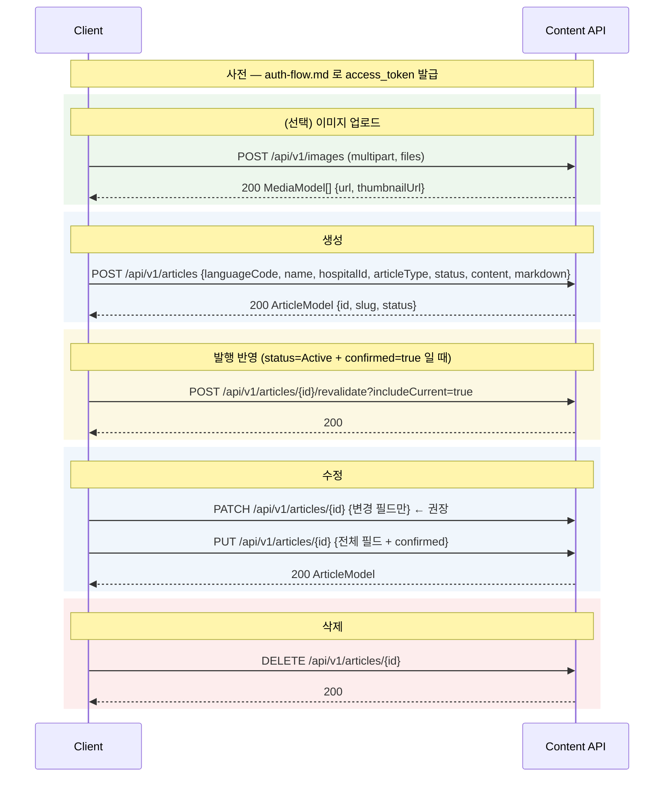

# Content API Flow — 아티클 생성 · 수정 · 삭제

## 개요

병원 매니저(LocalManager) 계정으로 발급받은 `access_token`(audience `hospital-content-api`)을 사용해 **Content API 서버(`API_BASE_URL`)** 에서 아티클을 관리하는 흐름입니다. 인증(토큰 발급)은 [auth-flow.md](auth-flow.md) 를 참고하세요.

모든 요청에 공통으로 붙습니다:

```
Authorization: Bearer {access_token}
Accept: application/json
Content-Type: application/json      # 이미지 업로드는 multipart/form-data
```

핵심 개념:
- **공개 조건은 4가지 AND**: `status == Active` **AND** 해당 언어 번역의 `IsConfirmed == true` **AND** 미삭제 **AND** 미숨김. 별도 publish 엔드포인트 없음.
  - `confirmed` 가 **두 번째 독립 발행 스위치**다. Admin 조회에는 이 필터가 없어 **관리 화면에는 보이는데 공개 사이트에는 안 보이는** 상태가 생긴다.
- 발행 후 **공개 사이트 반영은 `/revalidate?includeCurrent=true`** 로 트리거 (`includeCurrent` 없으면 no-op — 아래 3절).
- 아티클은 언어별 번역을 가지며, `languageCode` 로 대상 번역을 지정 (목록/조회도 이 언어로 필터링됨).
  해당 언어 번역이 없으면 **수정이 아니라 INSERT** 된다(upsert).
- 부분 수정은 `PATCH`, 전체 덮어쓰기는 `PUT`. **자동화·스크립트는 `PATCH` 권장** (아래 5절).

## 시퀀스 다이어그램



## 엔드포인트 상세

### 1) 이미지 업로드 (선택)

본문/커버에 넣을 이미지를 먼저 업로드해 공개 URL을 받습니다. **래스터 포맷만 지원** (JPEG/PNG/WebP/GIF/BMP/TIFF/TGA/PBM/QOI, **SVG 미지원**).

```
POST {API_BASE_URL}/api/v1/images
Content-Type: multipart/form-data

files=<binary>          # 필드명 "files", 여러 장 가능
```

응답:

```json
[
  {
    "id": "...",
    "url": "https://.../images/sample-xxxx.jpg",
    "thumbnailUrl": "https://.../thumbnails/sample-xxxx.webp"
  }
]
```

### 2) 아티클 생성

```
POST {API_BASE_URL}/api/v1/articles

{
  "languageCode": "en-US",           // 대상 번역 언어 (admin UI/목록이 이 언어로 필터링됨)
  "name": "Sample Article",          // 아티클 이름(제목)
  "title": "Sample Article",         // (선택)
  "description": "…",
  "content": "<p>본문 HTML…</p>",
  "markdown": "본문 markdown…",       // SaaS 페이지는 markdown 렌더 → 이미지는 
  "hospitalId": "GUID",              // 필수
  "articleType": "Blog",             // 필수. Blog / News / MedicalContent / Press / Insights …
  "status": "Active",                // Draft(미발행) / Active(발행) / Archived
  "photo": "https://.../image.jpg"   // (선택) 커버 이미지
}
```

응답: `ArticleModel` (`id`, `slug`, `status`, `hospitalId`, `name` …). `slug` 는 `name` 에서 자동 생성됩니다.

### 3) 발행 반영 (revalidate)

`status: "Active"` 로 저장해도 SaaS 공개 사이트는 캐시(ISR)라 즉시 반영되지 않습니다. 아래로 재검증을 트리거합니다. (`Draft`/`Archived` 는 불필요)

```
POST {API_BASE_URL}/api/v1/articles/{articleId}/revalidate?includeCurrent=true
```

⚠️ **`includeCurrent=true` 가 없으면 아무 일도 일어나지 않는다.** 서버 핸들러는 재검증 잡을
`if (request.IncludeCurrent)` 안에서만 큐에 넣고, 컨트롤러의 기본값은 `false` 다. 파라미터를 빼면
잡이 돌지 않은 채 `200 true` 가 돌아와 **성공한 것처럼 보인다.**

`includeCurrent` 는 "연관 엔티티 캐스케이드와 별개로, 지목한 엔티티 **자신의** 페이지도 재검증"이라는
서버 전역 컨벤션이다. Hospital 처럼 캐스케이드가 있는 엔티티는 이 플래그 없이도 일부 동작하지만,
**Article 은 캐스케이드 대상이 없어 이 분기가 동작의 전부다.**

재검증 대상은 해당 아티클의 **모든 언어 번역 slug + 과거 slug(리다이렉트용)** 페이지다.

### 4) 조회 / 목록

```
GET {API_BASE_URL}/api/v1/articles/{articleId}?languageCode=en-US&returnDefaultValue=true
GET {API_BASE_URL}/api/v1/articles?hospitalId={GUID}&languageCode=en-US&page=1&pageSize=10
```

- `languageCode` 를 생성 때와 맞추지 않으면(기본 en-US) 해당 번역이 없어 **조회/목록에서 빠질 수 있음**. `returnDefaultValue=true` 로 기본 언어 값 폴백 가능.

### 5) 아티클 수정 — `PATCH` 권장

|  | `PUT /{articleId}` | `PATCH /{articleId}` |
|---|---|---|
| 동작 | 전체 덮어쓰기 | 보낸 필드만 반영 (null-coalescing 병합) |
| 생략한 필드 | **기본값으로 덮어써짐** | 기존 값 유지 |
| 필수 | `languageCode`, `name` | 없음 |
| `confirmed` 생략 시 | **`false` → 비공개화** (non-nullable bool) | 기존 값 유지 (nullable) |
| 필드를 비우기 | 가능 | **불가** (생략과 구분 불가) |

```
PATCH {API_BASE_URL}/api/v1/articles/{articleId}

{
  "languageCode": "en-US",           // 수정할 번역 언어 (필수는 아니나 지정 권장)
  "content": "<p>변경된 본문…</p>",  // 보낸 필드만 바뀐다
  "markdown": "변경된 본문…"
}
```

```
PUT {API_BASE_URL}/api/v1/articles/{articleId}

{
  "languageCode": "en-US",           // 수정할 번역 언어 (필수)
  "name": "Sample Article — Updated", // 필수
  "content": "<p>변경된 본문…</p>",
  "markdown": "변경된 본문…",
  "hospitalId": "GUID",
  "status": "Active",
  "confirmed": true                  // ⚠️ 빠뜨리면 false 로 덮어써져 공개 사이트에서 사라진다
}
```

응답: 수정된 `ArticleModel`. 발행 상태면 `revalidate?includeCurrent=true` 로 반영.

> `src/articles.js` 의 `updateArticle()` 은 호출부가 `confirmed` 를 주지 않으면 자동으로 `true` 를 채운다.
> 직접 HTTP 로 호출한다면 이 보호가 없으므로 반드시 명시할 것.

#### 수정 시 제약

- **`slug` 는 바뀌지 않는다.** 본문에 `slug` 를 넣어도 무시된다(서버에서 의도적으로 비활성화 — SEO/URL 유지).
  변경하려면 `PUT /{articleId}/slug` 를 따로 호출한다.
- **`name` 은 UTF-8 250바이트 제한.** 글자 수가 아니라 바이트라서 **한글은 약 83자**가 상한.
  초과 시 `400 Name exceeds the maximum byte length(250)`.
- **`articleType` 은 `Blog` 또는 `MedicalContent` 만** 허용된다.
- **`content`/`markdown`/`photo` 등에 base64 인라인 바이너리 금지.** 이미지는 `/api/v1/images` 로 먼저 업로드하고 URL 을 넣는다.
- **`languageCode` 가 기존 번역과 다르면 수정이 아니라 새 번역이 INSERT 된다.** 오타가 데이터를 조용히 오염시키므로 주의.
- **`hospitalId` 변경은 Admin 권한에서만** 반영된다. 병원 계정이 보내면 무시된다.
- 해당 번역이 AI 번역 처리 중이면 `409 Translation is in progress`.

#### 동시성 주의

서버에 **낙관적 동시성 제어(ETag·버전·RowVersion)가 없다.** 같은 아티클을 사람과 스크립트가 동시에
편집하면 **나중 쓰기가 경고 없이 앞선 변경을 덮어쓴다.** 자동화를 만든다면 변경 이력
(`GET /{articleId}/histories`)의 마지막 작성자를 확인해 사람이 손댄 아티클은 건너뛰는 식의
방어를 애플리케이션 쪽에서 직접 넣어야 한다.

### 6) 아티클 삭제

```
DELETE {API_BASE_URL}/api/v1/articles/{articleId}
```

- 기본은 soft delete(보관 처리). 완전 삭제가 필요하면 `?isPermanent=true`, 특정 언어 번역만 지우려면 `?languageCode=…` 를 붙일 수 있습니다.

## 예제 매핑

| 단계 | 예제 |
|---|---|
| 생성 | `examples/02-create-article.js` (`npm run create`) |
| 이미지 업로드 + 생성 + 발행 | `examples/03-upload-image-and-publish.js` (`npm run publish`) |
| 수정 | `examples/04-update-article.js` (`npm run update -- <id>`) |
| 삭제 | `examples/05-delete-article.js` (`npm run delete -- <id>`) |

## 오류 처리

- **401** access_token 만료 → refresh 후 1회 재시도, 실패 시 재로그인 (auth-flow.md)
- **400** 잘못된 본문/미지원 이미지 포맷 등 — 응답 `errors` 에 상세. (샘플은 `describeError` 로 원인 노출)
- **429** `Retry-After` 존중, 없으면 지수 백오프

## 참조

- [인증 흐름 (auth-flow.md)](auth-flow.md)
- [README — 콘텐츠 발행과 revalidate](../README.md#콘텐츠-발행과-revalidate)
